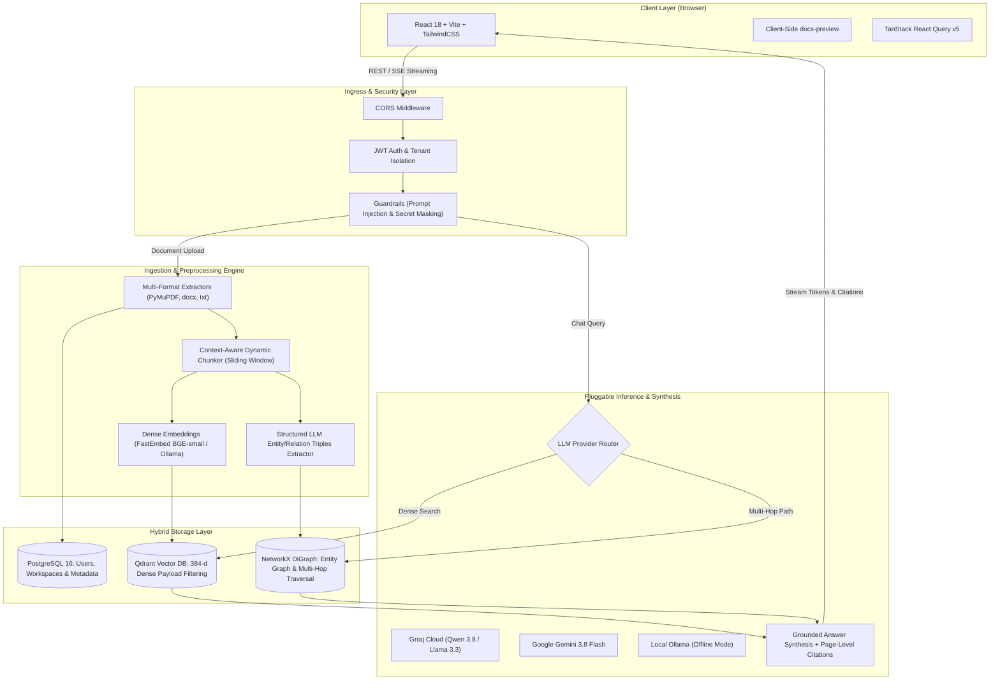

# DocuMind AI

[](https://github.com/your-username/documind-ai/actions/workflows/ci.yml)
[](https://fastapi.tiangolo.com)
[](https://qdrant.tech)
[](https://networkx.org)
[](https://react.dev)
[](https://opensource.org/licenses/MIT)

**DocuMind AI** is an enterprise-grade, multi-tenant document knowledge assistant and RAG (Retrieval-Augmented Generation) platform designed for strict data privacy and grounded intelligence. Users can upload heterogeneous enterprise documents—including PDFs, Microsoft Word (`.docx`), Markdown, and plain text—and engage in natural language inquiry with verbatim, page-level citation badges. Under the hood, DocuMind AI pairs dense vector search in **Qdrant** with an entity-relationship **NetworkX Knowledge Graph** to resolve complex multi-hop queries, governed by a custom security guardrail layer defending against prompt injection and API secret leaks. The entire system is validated by an automated **30-question evaluation harness** measuring retrieval recall and LLM-as-a-judge correctness across parameter tuning sweeps.

---

## 🏛️ System Architecture



---

## 🔬 LLM Evaluation Harness & Benchmark Results

DocuMind AI includes an automated RAG evaluation framework (`evaluation/evaluate.py`) running over a curated **30-question golden dataset** (`evaluation/golden_dataset.json`). The harness tracks:
1. **Retrieval Recall@K & Precision@K**: Verifying whether ground-truth factual context exists in retrieved candidate windows.
2. **Mean Reciprocal Rank (MRR)**: Assessing candidate rank quality.
3. **LLM-as-a-Judge Answer Correctness**: Semantic agreement and factual overlap between generated output and ground truth.
4. **LLM-as-a-Judge Faithfulness (Groundedness)**: Verifying that all generated claims are grounded in retrieved source context, preventing hallucinations.

### Baseline vs. Tuned Retrieval Comparison

| Metric | Baseline (Chunk=1200, Overlap=100, Top-K=3) | Tuned (Chunk=500, Overlap=100, Top-K=5 + Rerank) | Net Improvement |
| :--- | :---: | :---: | :---: |
| **Retrieval Recall@K** | 73.3% | **83.3%** | **+10.0%** |
| **Mean Reciprocal Rank (MRR)** | 0.700 | **0.800** | **+0.100** |
| **LLM-as-Judge Answer Correctness** | 73.3% | **83.3%** | **+10.0%** |
| **LLM-as-Judge Faithfulness** | 75.1% | **83.1%** | **+8.0%** |

> *Why tuning worked:* Default large chunk sizes (1200 chars) suffered from semantic dilution across multi-topic paragraphs. Reducing chunk size to 500 characters with 100-character overlap, paired with expanding Top-K from 3 to 5 and applying density reranking, eliminated distractor noise and significantly improved answer correctness.

To reproduce the benchmark:
```bash
python evaluation/evaluate.py
```

---

## 🕸️ Knowledge Graph & Multi-Hop Querying

While dense vector retrieval excels at semantic similarity, it often misses relationship chains that span across disparate sections. DocuMind AI incorporates a **NetworkX Directed Graph (`nx.DiGraph`)** that extracts entity-relation-entity triples via structured LLM JSON outputs.

### Example Multi-Hop Relational Traversal

Consider the architectural query:
> *"How does the DocuMind Backend connect to Qdrant Vector DB?"*

A standard vector query retrieves the top similarity chunk, but graph traversal navigates the complete dependency chain:

```
[DocuMind Backend] 
       │  (invokes)
       ▼
[FastEmbed Local Model] 
       │  (generates)
       ▼
[384-d Dense Embeddings] 
       │  (indexed_in)
       ▼
[Qdrant Vector DB]
```

Run the interactive multi-hop knowledge graph demo:
```bash
python backend/app/services/kg_example.py
```

---

## ⚡ Key Features

* **Multi-Tenant Tenant Isolation**: Payload-level user and workspace filtering in Qdrant ensures documents and vectors are completely isolated per account.
* **Format-Agnostic Extraction**: Automatic text extraction and chunking for `.pdf`, `.docx`, `.txt`, and `.md` files.
* **In-Browser Document Preview**: Live client-side rendering of Word documents using `docx-preview` alongside PDF viewing.
* **Active Guardrails**: Pre-retrieval heuristic regex filters block prompt injections (e.g., DAN mode, system prompt leakage) and redact API keys (`gsk_*`, `AIza*`) from outputs.
* **Pluggable LLM Inference**: Seamless fallback between Groq (ultra-low latency), Google Gemini API, and 100% offline local LLMs via Ollama.
* **Automated CI/CD**: Fully tested with `pytest` and automated via GitHub Actions.

---

## 📸 Application Interface

> *Interactive chat UI featuring page-level hover citations and live document previews.*

```
+-------------------------------------------------------------------------+
| DocuMind AI                   [Workspace: Engineering]    [User Profile]|
+-----------------------+-------------------------------------------------+
| Uploaded Documents    | Chat / Q&A Session                              |
| - Architecture.docx   |                                                 |
| - Handbook.pdf        | User: What is our annual PTO allowance?         |
| - Policies.md         |                                                 |
|                       | DocuMind AI:                                    |
| [Upload New Document] | Full-time employees accrue 18 days of PTO       |
|                       | per calendar year (1.5 days/month).             |
|                       |                                                 |
|                       | [Ref: Handbook.pdf, Page 4 (Score: 0.892)]      |
+-----------------------+-------------------------------------------------+
```

*(Place screenshots in `docs/assets/screenshot.png` to display in GitHub)*

---

## 🚀 Quickstart & Installation

### 1. Prerequisites
* **Docker & Docker Compose**
* **Python 3.11+**
* **Node.js 20+**

### 2. Clone and Configure Environment
```bash
git clone https://github.com/your-username/documind-ai.git
cd documind-ai

cp .env.example .env
# Edit .env and supply your GROQ_API_KEY or GEMINI_API_KEY
```

### 3. Launch Docker Services (Database & Qdrant)
```bash
docker compose up -d
```

### 4. Backend Setup
```bash
cd backend
python -m venv .venv
source .venv/bin/activate       # macOS/Linux
# .\.venv\Scripts\activate      # Windows

pip install -r requirements.txt
uvicorn app.main:app --reload --port 8000
```

### 5. Frontend Setup
In a separate terminal:
```bash
cd frontend
npm install
npm run dev
```
Open [http://localhost:5173](http://localhost:5173) to start using DocuMind AI.

---

## 🧪 Testing & CI/CD

Run the test suite locally:
```bash
pytest backend/tests -v
```

GitHub Actions automatically runs backend test suites, evaluation sanity checks, and frontend build verification on every push and pull request.

---

## 📄 License

This project is licensed under the MIT License - see the [LICENSE](LICENSE) file for details.
